# Installation and Administration Guide

This guide covers deployment of the Business API Ecosystem (BAE). Select compatible component versions from the
project's [stack definition](https://github.com/FIWARE-TMForum/Business-API-Ecosystem/blob/master/stack.yaml).
The TM Forum APIs are provided by [FIWARE/tmforum-api](https://github.com/FIWARE/tmforum-api), which supports
individual API services and an all-in-one application backed by an NGSI-LD broker.

## Installation with Docker

The installation with Docker requires the following:

- [Docker](https://docs.docker.com/engine/install/)
- [Docker Compose](https://docs.docker.com/compose/install/)

As stated, the Business API Ecosystem is made up of a set of different components which work jointly in order to provide
the functionality. In this regard the following images have been defined:

- `quay.io/fiware/tmforum-all-in-one`: Includes the TM Forum APIs in one service. Individual API images use the name `quay.io/fiware/tmforum-<module>`, such as `quay.io/fiware/tmforum-product-catalog`. Select the tag corresponding to the stack's `apis` version.
- `fiware/biz-ecosystem-charging-backend`: This image includes the Charging Backend component and can be found in [Docker Hub](https://hub.docker.com/r/fiware/biz-ecosystem-charging-backend/)
- `fiware/biz-ecosystem-logic-proxy`: This image includes the Logic Proxy component and can be found in [Docker Hub](https://hub.docker.com/r/fiware/biz-ecosystem-logic-proxy/)
- `fiware/biz-ecosystem-rss`: Optional separate Revenue Sharing Component, available in [Docker Hub](https://hub.docker.com/r/fiware/biz-ecosystem-rss/).

### TM Forum API deployment with Docker Compose

Include the API service and an NGSI-LD broker in the deployment network. The broker needs its own persistence;
follow the deployment instructions for the selected broker, such as Orion-LD or Scorpio.
The following service definition illustrates an all-in-one API connected to an Orion-LD service named `orion-ld`
on an existing Docker network named `bae`:

```yaml
services:
  tmf:
    image: quay.io/fiware/tmforum-all-in-one:1.15.1
    ports:
      - "8632:8632"
    environment:
      MICRONAUT_ENVIRONMENTS: in-memory,orion-ld
      MICRONAUT_HTTP_SERVICES_NGSI_URL: http://orion-ld:1026
      MICRONAUT_HTTP_SERVICES_NGSI_PATH: ngsi-ld/v1
      GENERAL_SERVER_HOST: http://tmf:8632
      API_EXTENSION_ENABLED: "true"
    networks:
      - bae

networks:
  bae:
    external: true
```

The broker and marketplace backend services must join the same network. `GENERAL_SERVER_HOST` is the API origin
reachable by the broker for subscription callbacks. Set the broker URL and profile to match the deployed broker.
The `in-memory` profile configures the application's local caches.
`API_EXTENSION_ENABLED=true` enables the customer-billing extension used to create and update applied billing rates.

Configure the Logic Proxy endpoint hosts, ports, and paths, and the Charging Backend service URLs to use this API service.
For example, Product Catalog Management is available at `http://tmf:8632/tmf-api/productCatalogManagement/v4`
inside this network. See [Configuring the TMF APIs](configuration-guide.md#configuring-the-tmf-apis) for the other
API base paths and [Backend API endpoints](configuration-guide.md#backend-api-endpoints) for the proxy settings.

After preparing the deployment's Compose file, network, broker, and component configuration, start the services with:

```bash
docker compose up -d
```

Stop the deployment with:

```bash
docker compose down
```

Deploy the frontend, Logic Proxy, Charging Backend, their MongoDB services, and the identity provider alongside the
API services. Use the [Configuration Guide](configuration-guide.md) for their connection settings and the
[Administrator Guide](admin-guide.md) for settings managed through the interface.

### Data storage

The different images used as part of the Business API Ecosystem provide several volumes. Following
it is described the different options available in each image.

When using the Logic Proxy's bundled portal, its theme and generated static directories are:

- `/opt/business-ecosystem-logic-proxy/themes`: This volume includes the different themes that can be used to customize the portal
- `/opt/business-ecosystem-logic-proxy/static`: This volume includes the static files ready to be rendered including the selected theme and js files

The bundled portal's static-file collection is controlled by `COLLECT` (`True` by default). For production startup
and the separate Angular frontend, see [Enabling Production](configuration-guide.md#enabling-production).

Mount persistent storage for the following Charging Backend directories:

- `/opt/business-ecosystem-charging-backend/src/media/bills`: This directory contains the PDF invoices generated by the Business Ecosystem Charging Backend
- `/opt/business-ecosystem-charging-backend/src/media/assets`: This directory contains the different digital assets uploaded by sellers to the Business Ecosystem Charging Backend
- `/opt/business-ecosystem-charging-backend/src/plugins`: This directory is used for providing asset plugins (see section *Installing Asset Plugins*)
- `/opt/business-ecosystem-charging-backend/src/wstore/asset_manager/resource_plugins/plugins`: This directory includes the code of the plugins already installed

### Installing Asset Plugins

As you may know, the Business API Ecosystem is able to sell different types of digital assets
by loading asset plugins in its Charging Backend. In this context, it is possible to install
asset plugins in the current Docker image as follows:

1. Copy the plugin file into the host directory of the volume `/opt/business-ecosystem-charging-backend/src/plugins`

2. Access the running container:

   ```bash
   docker exec -i -t your-container bash
   ```

3. Go to the installation directory:

   ```bash
   cd /opt/business-ecosystem-charging-backend/src
   ```

4. Load the plugin:

   ```bash
   python3 manage.py loadplugin ./plugins/pluginfile.zip
   ```

5. Restart the docker image:

   ```bash
   docker compose restart bae-charging
   ```

## Manual Installation

### Requirements

As described in the GEri overview, the Business API Ecosystem is not a single software, but a set of projects that
work together for providing business capabilities. In this regard, this section contains the basic dependencies of
the different components that made up the Business API Ecosystem.

#### TM Forum API requirements

- JDK 17 for the stack's API release (`1.15.1`).
- Maven for building from source.
- An NGSI-LD broker, such as Orion-LD or Scorpio, with its required database.

#### Optional RSS requirements

The separate Revenue Sharing Service has its own runtime and database:

- Java 8
- Glassfish 4.1
- MySQL 5.7

#### Charging Backend requirements

- Python 3.9
- MongoDB 4.4+
- wkhtmltopdf

#### Logic Proxy requirements

- NodeJS 16+ (Including NPM)
- MongoDB

Search is provided by the separate [TMF Search Engine](https://github.com/SEAMWARE/tmf-search-engine).
Follow that project's deployment instructions for its Elasticsearch dependency and indexing services.

### Installation

#### Installing TM Forum APIs

Clone the [FIWARE TM Forum API repository](https://github.com/FIWARE/tmforum-api) and select the release specified
by the stack's `apis` entry. For the current stack:

```bash
git clone https://github.com/FIWARE/tmforum-api.git
cd tmforum-api
git checkout 1.15.1
mvn clean install -Pbuild-only
```

The `build-only` profile builds the artifacts without starting the project's Kubernetes integration-test environment.
Each API module produces a JAR with runtime dependencies in its `target/lib/` directory. The `all-in-one` module
provides all APIs in one application. Keep the JAR and its `lib/` directory together when installing the artifacts.

Configure the broker URL, broker profile, callback origin, and API base paths as described in
[Configuring the TMF APIs](configuration-guide.md#configuring-the-tmf-apis).
The all-in-one application listens on port `8632` by default and exposes each API under its own `/tmf-api/.../v4` path.
Use those paths in the Logic Proxy and Charging Backend configuration.

The repository's [OpenAPI specifications](https://github.com/FIWARE/tmforum-api/tree/main/api/tm-forum) describe
the API resources and schemas. Select the same release when consulting the specifications.

#### Installing the RSS

The optional separate RSS sources can be found in [GitHub](https://github.com/FIWARE-TMForum/business-ecosystem-rss).

The first step for installing the RSS component is downloading it and moving to the correct release:

```bash
$ git clone https://github.com/FIWARE-TMForum/business-ecosystem-rss.git
$ cd business-ecosystem-rss
$ git checkout v8.0.0
```

Then, the next step is copying `database.properties` and `oauth.properties` files to their default location at `/etc/default/rss`:

```bash
$ sudo mkdir /etc/default/rss
$ sudo chown <your_user>:<your_user> /etc/default/rss
$ cp properties/database.properties /etc/default/rss/database.properties
$ cp properties/oauth.properties /etc/default/rss/oauth.properties
```

> **Note:** You have to include your user when changing the `rss` directory owner.

Once the properties files have been copied, they should be edited in order to provide the correct configuration params.

`database.properties`:

```
database.url=jdbc:mysql://localhost:3306/RSS
database.username=root
database.password=root
database.driverClassName=com.mysql.jdbc.Driver
```

`oauth.properties`:

```
config.grantedRole=Provider
config.sellerRole=Seller
config.aggregatorRole=aggregator
```

> **Note:** The different params included in the configuration file are explained in detail in the Configuration section.

Once the properties files have been edited, the next step is compiling the sources with Maven:

```bash
$ mvn install
```

Finally, the last step is deploying the generated war file in Glassfish:

```bash
$ asadmin deploy --contextroot DSRevenueSharing --name DSRevenueSharing fiware-rss/target/DSRevenueSharing.war
```

#### Installing the Charging Backend

The Charging Backend sources can be found in [GitHub](https://github.com/FIWARE-TMForum/business-ecosystem-charging-backend).

The first step for installing the charging backend component is downloading it and moving to the correct release:

```bash
$ git clone https://github.com/FIWARE-TMForum/business-ecosystem-charging-backend.git
$ cd business-ecosystem-charging-backend
```

Once the code has been downloaded, it is recommended to create a virtualenv for installing python dependencies (this is not mandatory).

```bash
$ virtualenv virtenv
$ source virtenv/bin/activate
```

To install python dependencies use pip tool:

```bash
$ pip3 install -r requirements.txt
```

If you are planning to run the tests or develop, you should install the development dependencies:

```bash
$ pip3 install -r dev-requirements.txt
```

#### Installing the Logic Proxy

The Logic Proxy sources can be found in [GitHub](https://github.com/FIWARE-TMForum/business-ecosystem-logic-proxy).

The first step for installing the logic proxy component is downloading it and moving to the correct release:

```bash
$ git clone https://github.com/FIWARE-TMForum/business-ecosystem-logic-proxy.git
$ cd business-ecosystem-logic-proxy
```

Once the code has been downloaded, Node dependencies can be installed with NPM:

```bash
$ npm install
```

### Final steps

#### Media and Indexes

The Business API Ecosystem allows to upload some product attachments and assets to be sold. These assets are uploaded
by the Charging Backend that saves them in the file system, jointly with the generated PDF invoices.

In this regard, the directories `src/media`, `src/media/bills`, and `src/media/assets` must exist within the Charging Backend directory, and must
be writable by the user executing the Charging Backend.

```bash
$ mkdir src/media
$ mkdir src/media/bills
$ mkdir src/media/assets
$ chown -R <your_user>:<your_user> src/media
```

The Logic Proxy stores its application data and saved marketplace settings in MongoDB. Search indexing is managed
by the separate [TMF Search Engine](https://github.com/SEAMWARE/tmf-search-engine). Follow its
[configuration guide](https://github.com/SEAMWARE/tmf-search-engine/blob/main/doc/configuration-guide.md)
for connecting it to the TM Forum APIs and Elasticsearch, and configure the marketplace's search endpoint as described
in [Search engine integration](configuration-guide.md#search-engine-integration).

### Running the Business API Ecosystem

#### Running the TM Forum APIs

Start the NGSI-LD broker and its database first. From the API repository, start the built all-in-one application:

```bash
export MICRONAUT_ENVIRONMENTS=in-memory,orion-ld
export MICRONAUT_HTTP_SERVICES_NGSI_URL=http://localhost:1026
export MICRONAUT_HTTP_SERVICES_NGSI_PATH=ngsi-ld/v1
export GENERAL_SERVER_HOST=http://localhost:8632
export API_EXTENSION_ENABLED=true
java -jar all-in-one/target/all-in-one-0.1.jar
```

These example URLs assume the API and broker run on the same host. Set the broker URL and `GENERAL_SERVER_HOST`
to addresses reachable by their respective callers. The JAR filename reflects the Maven version in the checked-out
release; use the generated filename when building a different release.

For individual API services, start each module's JAR with its own port, callback origin, and base path.
Use the [Configuration Guide](configuration-guide.md#configuring-the-tmf-apis) to align these values with the marketplace.

#### Running the optional RSS

For deployments using the separate RSS, start its Glassfish domain:

```bash
asadmin start-domain
```

#### Running the Charging Backend

Start the TM Forum API services and MongoDB before starting the Charging Backend, which creates objects and connections
during startup.

**Using Django runserver**

The Charging Backend can be started using the `runserver` command provided with Django as follows:

```bash
$ python3 manage.py runserver 127.0.0.1:<charging_port>
```

> **Note:** If you have created a virtualenv when installing the backend or used the installation script, you will need to activate the virtualenv before starting the Charging Backend.

**Using Gunicorn**

The Charging Backend can be deployed in production using Gunicorn. To do that execute the following command:

```bash
$ gunicorn wsgi:application --workers 1 --forwarded-allow-ips "*" --log-file - --bind 0.0.0.0:8006 --log-level INFO
```

#### Running the Logic Proxy

The Logic Proxy can be started using Node as follows:

```bash
$ node server.js
```

## Sanity check Procedures

The Sanity Check Procedures are the steps that a System Administrator will take to verify that an installation is ready
to be tested. This is therefore a preliminary set of tests to ensure that obvious or basic malfunctioning is fixed before
proceeding to unit tests, integration tests and user validation.

### End to End Testing

Please note that the following information is required before starting with the process:

- The host and port where the Proxy is running
- A valid IdM user with the *Seller* role

To Check if the Business API Ecosystem is running, follow the next steps:

1. Open a browser and enter to the Business API Ecosystem
2. Click on the *Sign In* Button

   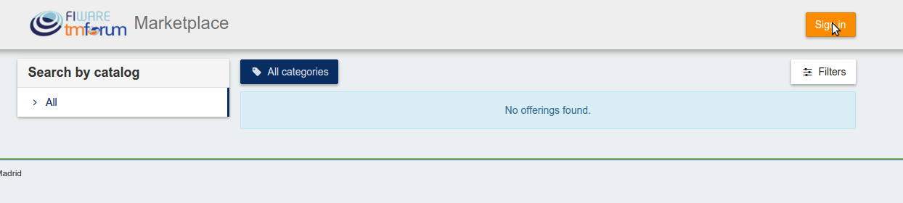

3. Provide your credentials in the IdM page

   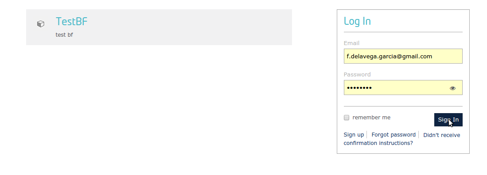

4. Go to the *Revenue Sharing* section

   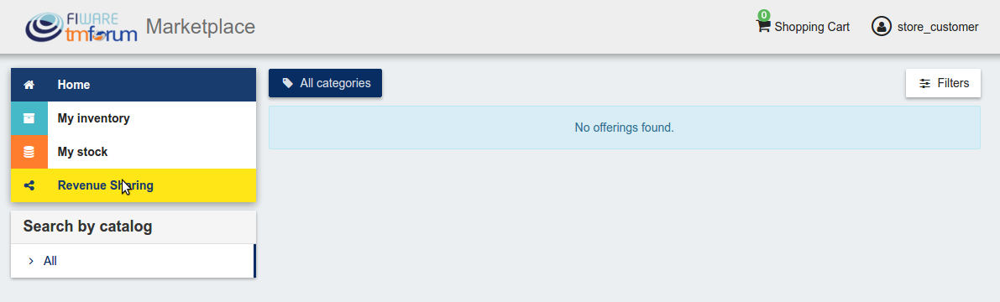

5. Ensure that the default RS Model has been created

   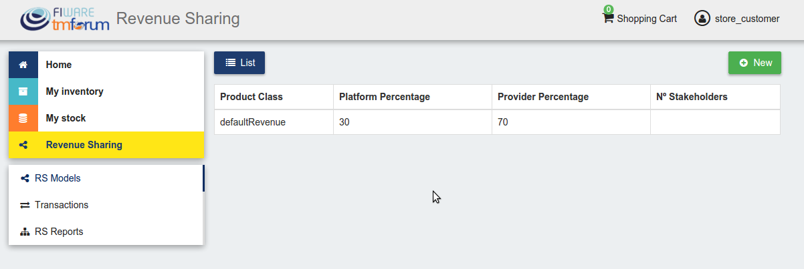

6. Go to *My Stock* section

   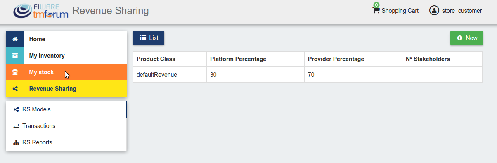

7. Click on *New* for creating a new catalog

   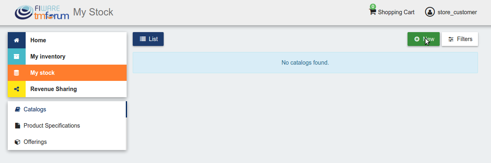

8. Provide a name and a description and click on *Next*. Then click on *Create*

   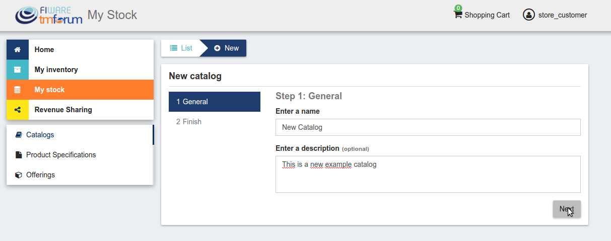
   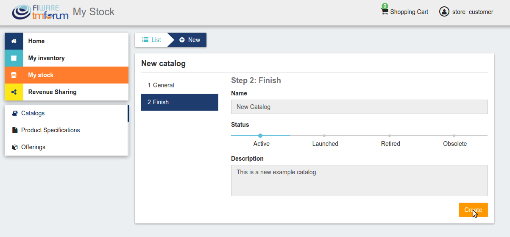
   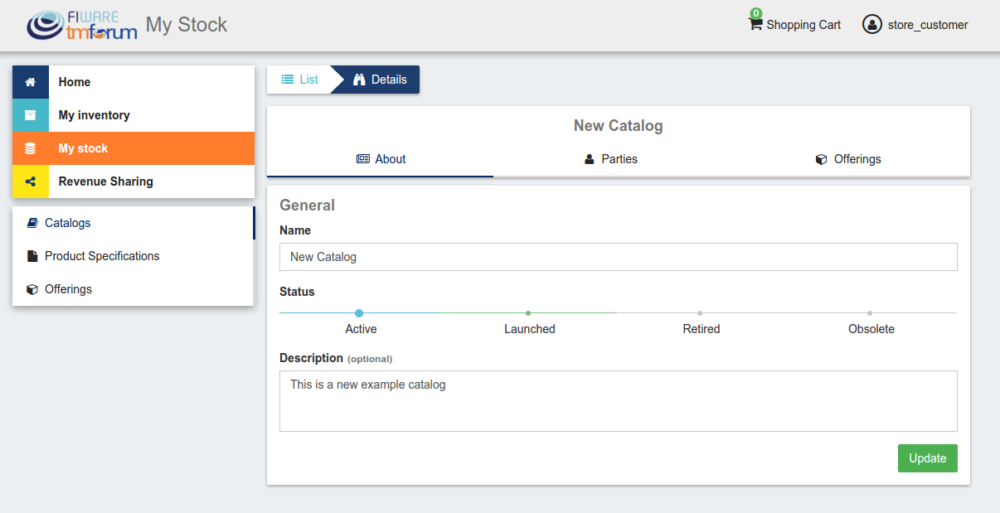

9. Click on *Launched*, and then click on *Update*

   
   

10. Go to *Home*, and ensure the new catalog appears

    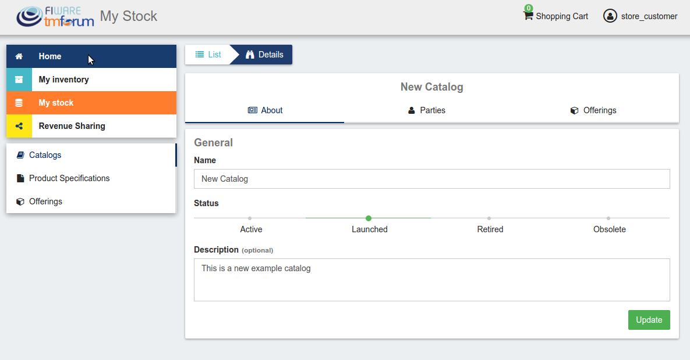
    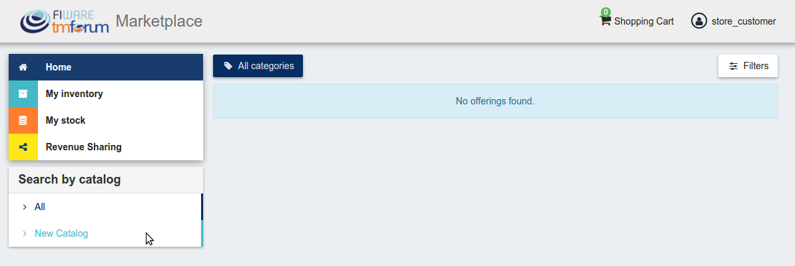
